# 노란 튜브 과제 — 정책 입력 색 바꾸기 시험 (FR5)

빨간 튜브를 빨간 링 칸에 꽂도록 학습한 GR00T N1.7 정책을 다시 학습하지 않고 노란 튜브 과제에 썼다.
로봇에는 노란 튜브(목표), 빨간 튜브(방해물), 노란 링을 놓고, 정책에 들어가는 두 카메라 영상에서만 노랑과 빨강을 맞바꿨다.
정책에는 학습 때와 같은 장면(빨간 튜브 · 노란 튜브 · 빨간 링)이 보이고, 지시문도 그대로다.

```
put the red tube in the red slot
```

> 2026-11-13 하루 동안 배치를 바꿔 가며 돌린 **탐색 시험**이다. 본 평가 결과가 아니다.
> 배치마다 시행 수가 1–7회로 다르고, 같은 배치 번호 안에서도 튜브 자리를 옮긴 판이 있다.

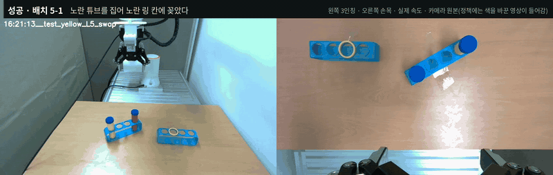

배치 5-1 성공. 왼쪽 3인칭, 오른쪽 손목. 영상은 카메라 원본이고, 정책에는 색을 바꾼 영상이 들어갔다(2배속, [mp4](media/success_L5-1.mp4)).

---

## 결과

| 노란 튜브 과제 (유효 시행) | 시행 | 성공 | 부분 | 실패 |
|---|---|---|---|---|
| 배치 1–10, 기본 색 바꾸기 | 19 | 3 | 2 | 14 |
| 배치 11, 튜브를 꽉 찬 색으로 바꾸기 | 7 | 1 | 4 | 2 |
| **합** | **26** | **4 (15 %, Wilson 95 % 6–34 %)** | 6 | 16 |
| 빨간 튜브 과제 확인 (색 바꾸기 없음, 같은 모델 · 같은 날) | 4 | 1 | 1 | 2 |

운영자가 무효로 표시한 18회는 표에서 뺐다. 기록에 남은 사유는 아래와 같다.
- 링 칸을 잘못 지정함: 3회
- 녹화 설정 때문에 시작 직후 멈춤: 2회
- 안전 검사로 멈춤: 1회
- 빨간 튜브를 하나 더 둔 채 시작함: 1회
- 처음 닫을 때 빈손으로 끝났고 사유 메모가 없음: 11회 (배치 1-1, 3-1~3-4, 8-1)

이 11회까지 실패로 세면 노란 튜브 과제는 37회 중 4회 성공이다.

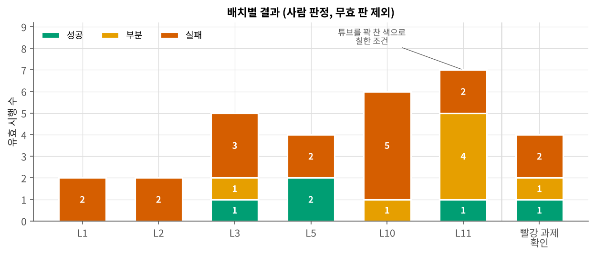

- 성공 4회는 배치 3-5, 5-1, 5-2, 11-2다. 네 판 모두 노란 튜브 중심에서 8–26 mm 떨어진 곳에서 그리퍼를 닫았고, 노란 링 칸 중심에서 3–12 mm 떨어진 곳에서 놓았다.
- 배치 1–10에서 처음 닫은 자리는 19회 중 12회가 노란 튜브 쪽, 7회가 빨간 튜브 쪽이었다. 빨간 튜브 쪽 7회는 모두 실패다. 그중 4회는 빨간 튜브를 들고 가서 노란 링 칸 30 mm 안에서 놓았다.
- 노란 튜브 쪽에서 닫았지만 잡지 못한 판은 9회다. 노란 튜브 중심에서 13–51 mm 떨어진 곳에서 닫았다.
- 배치 11은 7회 모두 노란 튜브 쪽에서 닫았다. 이 배치는 빨간 튜브가 닫은 자리에서 223–265 mm 떨어져 있었다.
- 배치 5에서 노란 튜브와 빨간 튜브의 자리를 맞바꾸자(5-3, 5-4), 그리퍼는 앞 판(5-1, 5-2)과 같은 구멍 근처에서 닫았고 두 번 다 빨간 튜브를 잡았다.
- 정책 한 번 묻고 받는 왕복 시간의 중간값은 노란 튜브 과제 420 ms, 빨간 튜브 과제 확인 306 ms였다. 색 바꾸기 자체는 영상 한 장에 12–16 ms 걸렸다.

### 이 시험으로 말할 수 없는 것

- 배치 11은 색 처리만 바꾼 것이 아니라 배치도 앞 배치들과 다르다. 꽉 찬 색으로 바꾸기의 효과만 따로 떼어 말할 수 없다.
- 같은 배치에서 색 바꾸기를 켜고 끈 비교는 하지 않았다. 빨간 튜브 과제 확인은 한 배치에서 4회뿐이다.
- 배치 11과 빨간 튜브 과제 확인은 영상 녹화기가 꺼져 있어 영상이 없다. 사진과 로봇 기록으로만 보였다.

---

## 영상

| 성공 · 배치 5-1 | 실패 · 배치 5-3 | 실패 · 배치 10-2 |
|---|---|---|
|  | 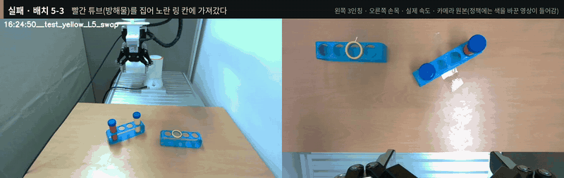 | 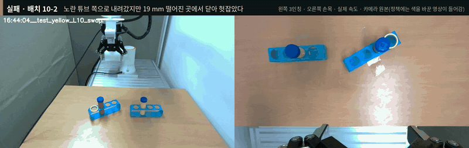 |
| 노란 튜브를 집어 노란 링 칸에 꽂았다 | 빨간 튜브를 집어 노란 링 칸으로 가져갔다 | 노란 튜브 앞 19 mm에서 닫아 헛잡았다 |
| [mp4](media/success_L5-1.mp4) | [mp4](media/wrong_tube_L5-3.mp4) | [mp4](media/grasp_miss_L10-2.mp4) |

GIF는 2배속, mp4는 실제 속도다. 실행 구간만 잘랐다.

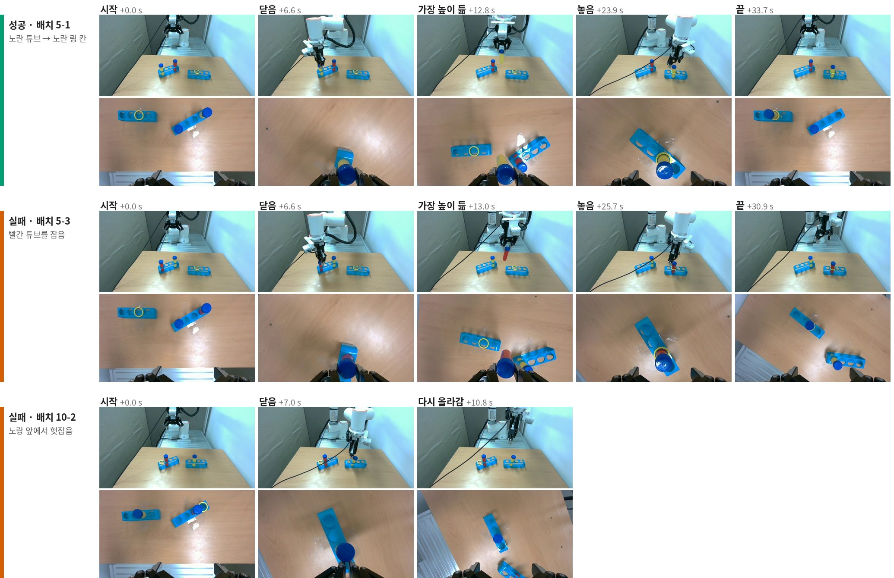

---

## 색 바꾸기

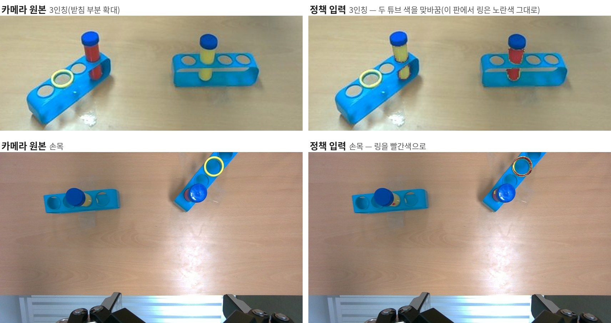

배치 11-2 시작 장면. 왼쪽이 카메라 원본, 오른쪽이 정책에 들어간 영상이다.
이 판에서는 3인칭 화면의 링 색이 바뀌지 않고 노란색 그대로 들어갔다. 손목 화면에서는 링이 빨간색으로 바뀌었다.

1. 시작할 때 원래 색의 3인칭 영상으로 받침, 노란 튜브, 빨간 튜브 자리를 찾는다. 빈 구멍마다 링이 놓일 자리의 노란 화소 비율을 재서 노란 링 칸을 고른다.
2. 정책에 묻기 직전에 3인칭 · 손목 영상에서 튜브 몸통(원기둥)과 링(고리)이 보일 자리를 카메라 보정값으로 계산하고, 그 안의 화소만 바꾼다. 색으로 찾지 않고 자리로 찾는다. 노란 튜브와 책상(나무색)이 색조가 비슷해 색만으로는 나눌 수 없었다.
3. 노란 튜브는 학습 영상의 빨간 튜브 색으로, 빨간 튜브는 노란 튜브 색으로, 노란 링은 빨간 링 색으로 바꾼다. 바꿀 색(색조 · 채도 · 밝기 분포)은 학습 200판 영상에서 쟀다.
4. 튜브를 쥐면 그 튜브의 마스크는 손끝을 따라가고, 놓으면 놓은 자리에 남는다.

배치 11에서는 `FR5_SWAP_SOLID=1`로 3인칭 튜브를 꽉 찬 색으로 바꿨다. 튜브 마스크 전체의 색 분포를 기준으로 맞추고, 채도는 ±1.5σ, 밝기는 ±2.5σ 안으로 묶었다. 기본 설정에서는 옅거나 빛을 받아 반짝이는 화소가 원래 색에 가깝게 남았다.

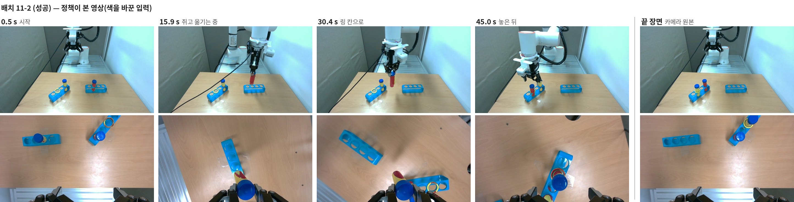

배치 11-2(성공) 동안 정책이 받은 영상(위 3인칭, 아래 손목)이다. 쥔 노란 튜브는 빨간색으로 칠해져 손끝을 따라갔다. 맨 오른쪽은 끝난 뒤 카메라 원본이다.

---

## 배치와 닫은 자리

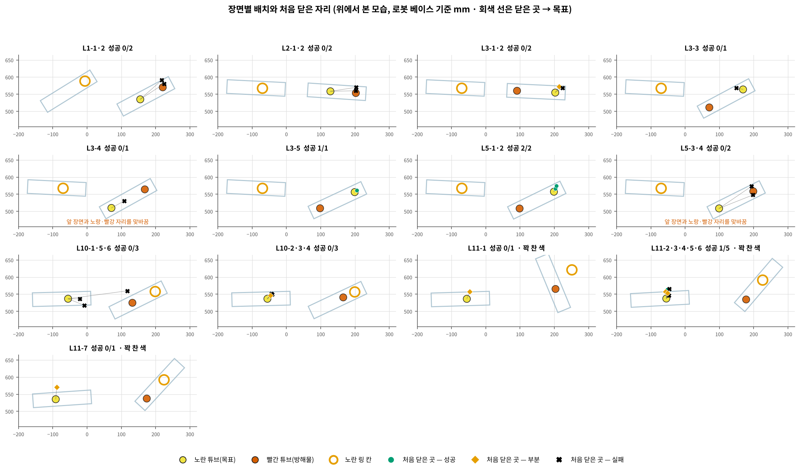

같은 배치 번호 안에서 튜브 자리를 옮긴 판은 장면을 나눠 그렸다. 회색 선은 처음 닫은 자리에서 노란 튜브까지다.

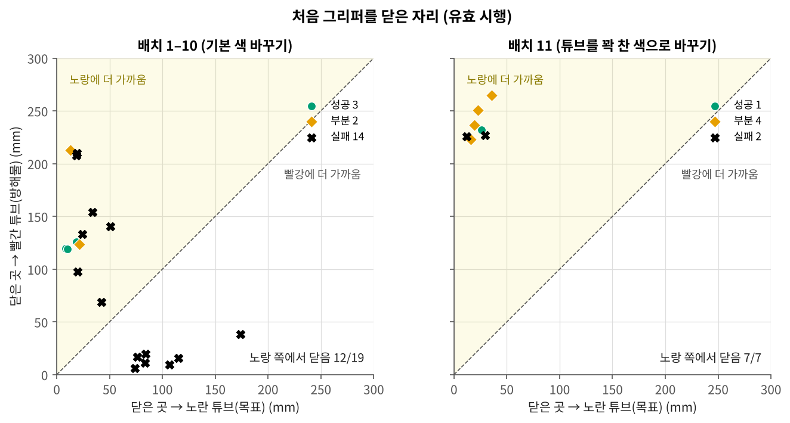

가로축은 처음 닫은 자리에서 노란 튜브(목표)까지, 세로축은 빨간 튜브(방해물)까지의 거리다. 점선 위쪽은 노란 튜브에 더 가깝게 닫은 판이다.

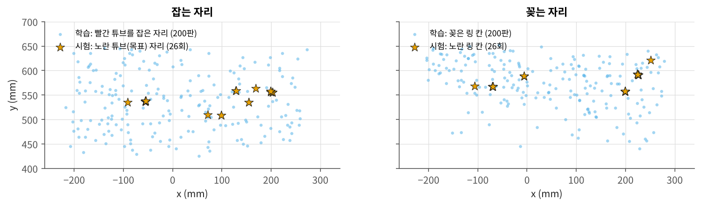

파란 점은 학습 200판에서 빨간 튜브를 잡은 자리와 꽂은 링 칸, 별은 이번 시험의 노란 튜브 자리와 노란 링 칸이다.

---

## 한 판 자세히 — 배치 11-2 (성공)

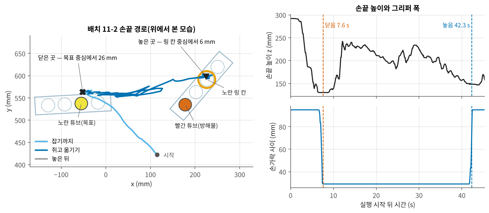

시작한 지 7.6 s에 노란 튜브 중심에서 26 mm 떨어진 곳에서 닫았고, 그리퍼 폭 29 mm로 튜브를 쥐었다.
42.3 s에 노란 링 칸 중심에서 6 mm 떨어진 곳에서 놓았다.

---

## 구성

| | |
|---|---|
| 로봇 | FAIRINO FR5, DH AG-160-95 그리퍼, 3인칭 · 손목 카메라 848×480 |
| 정책 | GR00T N1.7 (3B), 실물 200판(3번 반복) + 시뮬 600판 = 1200판, batch 64, 20,000 스텝. 노란 튜브 데이터는 없다 |
| 실행 | 행동 16개를 받아 앞 8개를 실행하고 다음을 묻는다. 정책 서버는 GPU 서버, 로봇 쪽 실행 컴퓨터와 SSH 터널로 연결 |
| 색 바꾸기 | [tools/fr5_swap.py](tools/fr5_swap.py) — 실행 스크립트 `fr5_policy_try.py`(v6.6d)의 `--swap`이 불러 쓴다. 자동 수집기 패키지(`fr5auto`)의 카메라 보정 · 받침 인식을 쓴다 |
| 판정 | 사람 판정. 노란 튜브가 노란 링 칸에 꽂히면 성공이다. 빨간 튜브를 잡거나 옮기면 실패다. 그 밖의 판은 운영자가 부분과 실패로 나눴다 |

## 자료

| 파일 | 내용 |
|---|---|
| [data/trials.csv](data/trials.csv) | 유효 시행 30회(노란 튜브 26 + 빨간 튜브 확인 4). 판정, 로봇 기록으로 나눈 단계(잡기 · 들기 · 칸 위로 · 꽂기 · 놓기 · 끝 장면), 목표 · 방해물 · 링 칸 자리, 처음 닫은 자리와 놓은 자리, 그 사이 거리, 왕복 시간 |
| [data/racks.csv](data/racks.csv) | 판마다 시작 장면에서 찾은 받침 두 개의 중심과 방향 |
| [data/train_positions.csv](data/train_positions.csv) | 학습 200판의 빨간 튜브 자리와 링 칸 자리 |
| [data/trial_11-2_tcp.csv](data/trial_11-2_tcp.csv) | 배치 11-2의 손끝 위치와 그리퍼 폭(10 Hz) |
| [data/trial_11-2_policy.csv](data/trial_11-2_policy.csv) | 배치 11-2에서 정책이 낸 행동 묶음(질의마다 16개, 손끝 위치 mm와 그리퍼 값) |

좌표는 로봇 베이스 기준 mm다. x는 좌우, y는 앞쪽이다. 단계 열은 로봇 기록으로 자동 판정한 값이라 사람 판정(`verdict`)과 다를 수 있다.

그림은 `python3 tools/make_figures.py`로 `data/`에서 다시 만든다. 사진 그림(`swap_views.jpg`, `l11-2_policy_view.jpg`, `keyframes.jpg`)과 `media/`는 시험 기록에서 바로 잘라 붙였다.
